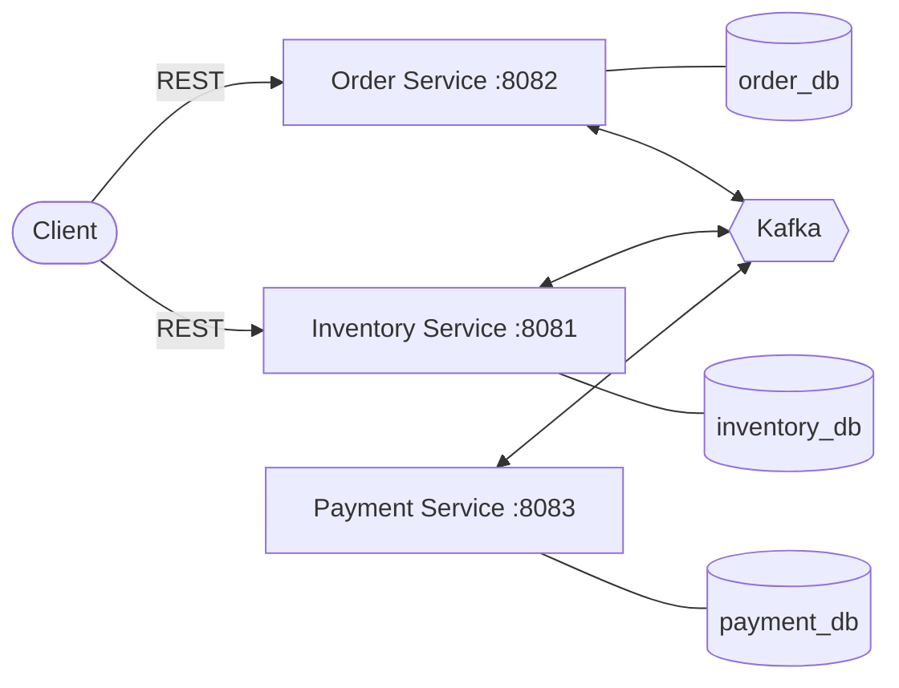
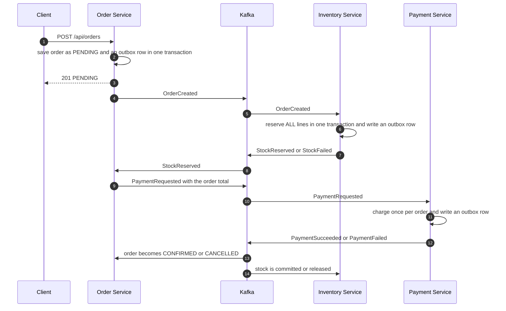

# E-commerce Microservices: Saga, Outbox and Kafka


An event-driven e-commerce backend made of three independent Spring Boot services. A customer places an order, and the services cooperate through Kafka to reserve stock, take payment, and confirm or cancel the order. Every failure (no stock, declined payment, duplicate messages, a service being down) is handled and tested, and the whole flow is measured with Prometheus, Grafana and a k6 load test.

**Stack:** Java 21, Spring Boot 3.5, Apache Kafka, PostgreSQL, Flyway, Micrometer, Prometheus, Grafana, k6, Testcontainers, GitHub Actions.

## Architecture

Each service owns its own database and talks to the others only through Kafka events.



Kafka topics: `order-events`, `inventory-events`, `payment-events`.

## Order flow



## What happens when things go wrong

| Scenario | Result |
|---|---|
| Enough stock and payment succeeds | Order `CONFIRMED`, stock committed |
| Not enough stock | `StockFailed`, order `CANCELLED`, nothing reserved |
| Multi-item order where one line is short | All or nothing: nothing reserved, order `CANCELLED` |
| Payment declined | `PaymentFailed`, reserved stock released, order `CANCELLED` |
| Same event delivered twice | Ignored (idempotent consumers, see below) |
| A service is down | Events wait in the outbox and in Kafka, processed when it restarts |
| Many buyers fight for the last units | Optimistic locking: stock is never oversold |
| More load than the system can handle | Orders get slower but none are lost (see Performance) |

## Design decisions

- **Database per service.** Services share no tables. They reference each other by ID only, with no cross-service foreign keys.
- **Transactional outbox.** A service writes its business change and the event to an `outbox` table in the **same transaction**, and a poller publishes the rows to Kafka. This avoids the "saved to the database but the event was lost" problem. Delivery is at-least-once, so consumers must be idempotent. The poller runs every 100 ms, sends batches of up to 200 rows without waiting for each acknowledgement, and marks the whole batch published with one `UPDATE`. Events for the same order share a key, so they stay in order.
- **Idempotent consumers.** Inventory skips lines it already reserved (unique `order_id + product_id`). Payment charges an order at most once (unique `order_id`). Order state changes (`confirm`, `cancel`) are safe to repeat.
- **Optimistic locking with retry.** `Inventory` has a `@Version` column. The conflict is raised when the transaction commits, so the retry must wrap the whole transaction. The service uses `TransactionTemplate` inside `@Retryable`, because putting `@Retryable` and `@Transactional` on the same method does not guarantee that order.
- **All-or-nothing reservation.** All lines of an order are reserved in one transaction, so a failure never leaves partial reservations.
- **Choreography saga with compensation.** Services react to each other's events. A failed payment triggers the compensating action (release stock, cancel order).
- **Flyway migrations** manage each schema, and Hibernate only validates it (`ddl-auto=validate`).

## Running locally

**Requirements:** JDK 21 or newer, Maven, Docker.

```bash
# 1. start Kafka, the three databases, Prometheus and Grafana
docker compose up -d

# 2. start each service in its own terminal (or run the main class from your IDE)
cd inventory-service && mvn spring-boot:run
cd order-service     && mvn spring-boot:run
cd payment-service   && mvn spring-boot:run
```

| Service | Port | Database |
|---|---|---|
| Inventory | 8081 | `inventory_db` on 5433 |
| Order | 8082 | `order_db` on 5434 |
| Payment | 8083 | `payment_db` on 5435 |
| Kafka | 9092 | |
| Prometheus | 9090 | |
| Grafana | 3000 | |

### Try it

```bash
# create a product with 10 units in stock (note the returned id)
curl -X POST localhost:8081/api/products -H "Content-Type: application/json" \
  -d '{"sku":"SKU-1","name":"Keyboard","price":49.99,"initialStock":10}'

# place an order for 2 units (use the product id from above)
curl -X POST localhost:8082/api/orders -H "Content-Type: application/json" \
  -d '{"customerId":"aaaaaaaa-aaaa-aaaa-aaaa-aaaaaaaaaaaa","items":[{"productId":"<product id>","quantity":2,"unitPrice":49.99}]}'
```

A few seconds later the order is `CONFIRMED` (`GET /api/orders/<id>`), the payment shows `SUCCESS` (`GET localhost:8083/api/payments/<id>`), and the inventory shows 8 available. To see a payment failure, order with `"unitPrice":600` and `"quantity":2`. The fake gateway declines anything above 1000.

## API

| Service | Endpoint | Purpose |
|---|---|---|
| Order | `POST /api/orders` | Place an order (starts as `PENDING`) |
| Order | `GET /api/orders/{id}` | Get an order |
| Order | `GET /api/orders?customerId=` | List a customer's orders |
| Inventory | `POST /api/products` | Create a product with initial stock |
| Inventory | `GET /api/products`, `GET /api/products/{id}` | Read products |
| Inventory | `GET /api/inventory/{productId}` | Available and reserved stock |
| Inventory | `POST /api/inventory/{productId}/stock` | Add stock |
| Inventory | `/api/reservations/...` | Reserve, view, release and commit (used for testing, the saga calls the same code through Kafka) |
| Payment | `GET /api/payments/{orderId}` | Payment result for an order |

## Observability

Every service exposes metrics at `/actuator/prometheus`. Prometheus scrapes them every 5 seconds, and Grafana opens a ready-made **E-commerce saga** dashboard at `http://localhost:3000` (12 panels).

<!-- Screenshot: save it as docs/dashboard.png, then delete the two comment markers around the next line.

-->

Business metrics added on top of the standard JVM, HTTP and connection-pool metrics:

| Metric | Meaning |
|---|---|
| `orders_created_total` | Orders placed |
| `orders_saga_duration_seconds` (tag `outcome`) | Time from order placed until it was confirmed or cancelled |
| `inventory_reservations_total` (tag `result`) | Stock reservation attempts, `reserved` or `rejected` |
| `payments_processed_total` (tag `status`) | Payments by `success` or `failed` |
| `outbox_pending` | Outbox rows not yet published to Kafka (a growing number means a backlog) |

## Performance

Load test: [k6](https://k6.io) ramps the offered load up to **15 orders per second** over 50 products, then polls each order once per second until it is `CONFIRMED` (30 second timeout). Run it with Docker:

```bash
# Windows Command Prompt, from the repository root
docker run --rm -i -v "%cd%\load-test:/scripts" -e ORDER_URL=http://host.docker.internal:8082 -e INVENTORY_URL=http://host.docker.internal:8081 -e PEAK_RATE=15 -e POLL_SECONDS=1 grafana/k6 run /scripts/order-flow.js

# macOS / Linux / Git Bash
docker run --rm -i -v "$(pwd)/load-test:/scripts" -e ORDER_URL=http://host.docker.internal:8082 -e INVENTORY_URL=http://host.docker.internal:8081 -e PEAK_RATE=15 -e POLL_SECONDS=1 grafana/k6 run /scripts/order-flow.js
```

**Hardware:** an 8 GB laptop running the three services, Kafka, three PostgreSQL databases, Prometheus, Grafana, the IDE and k6 all at once. The numbers show the shape of the system, not what a production deployment would achieve.

### How it was tuned

The first run exposed a bottleneck, which the Grafana dashboard made visible: the **outbox backlog climbed to about 800 rows** and the database **connection pool was fully used (10 of 10)**, while heap and CPU stayed low. So the limit was in the design, not the machine. Changes made:

1. **Outbox publisher:** from "50 rows per second, one acknowledgement at a time" to batches of up to 200 rows, sent asynchronously, polled every 100 ms, marked published with one `UPDATE`.
2. **Kafka consumers:** 3 threads per listener (one per partition).
3. **Connection pool:** 10 to 20 connections per service.

| Peak 15 orders/s offered | Before | After tuning (first run) | After tuning (latest run) |
|---|---|---|---|
| Orders confirmed within 30 s | 17 to 29% | 98.8% | **100%** |
| `POST /api/orders` p95 | 1.6 to 5.5 s | 1.8 s | **0.58 s** |
| Placed to confirmed, median | most timed out | 12.4 s | **2.3 s** |
| Placed to confirmed, p95 | most timed out | 28.9 s | **9.9 s** |

Notes on reading this: the k6 timing has a 1 second granularity because of the polling, the "before" runs polled the API more heavily than the later ones, and single runs on a laptop vary, so treat the gains as directional. The fastest confirmation is about 1 second. During the 60 second peak a queue still builds and drains afterwards, so 15 orders per second is close to what this setup sustains.

### Correctness under overload

After the overload runs: all 1,034 orders of the first run ended `CONFIRMED` with zero unpublished outbox rows, and the Kafka offsets after all three runs (3,217 orders) show exactly two events per order on `order-events` and one each on `inventory-events` and `payment-events`, with every consumer group fully caught up. Under overload the system became slower, never wrong.

## Testing

- **Unit tests** cover the domain rules: stock arithmetic, order state transitions, and the payment limit.
- **Integration tests with Testcontainers** start a real PostgreSQL and Kafka in Docker and cover:
  - reservation writes its event and is idempotent
  - multi-item all-or-nothing behaviour
  - release and commit are repeatable
  - **10 concurrent buyers competing for 5 units never oversell**
  - real events through a real broker: `OrderCreated` leads to a reservation, `PaymentFailed` releases stock, and `PaymentSucceeded` commits it
- **GitHub Actions** builds and tests all three services on every push and pull request.
- **k6 load test** (see Performance) exercises the whole saga end to end.

Run the tests locally with `mvn verify` inside a service folder (Docker must be running for the inventory tests).

## Known limitations and roadmap

- `unitPrice` and `customerId` are trusted from the request. Next: look prices up from the Inventory Service and take the customer from a JWT.
- No API gateway or authentication yet.
- Failed messages are retried and then skipped. A dead-letter topic would keep them for inspection.
- The outbox poller can publish a row twice (safe because consumers are idempotent). With several instances, `SELECT ... FOR UPDATE SKIP LOCKED` or Debezium would be better, and published rows should be cleaned up.
- The payment gateway is a fake called inside the database transaction. A real provider would be called outside it, with an idempotency key.
- Kafka runs as a single broker, and the benchmark ran on one laptop, so there is no horizontal-scaling result yet.
- Planned: API gateway with JWT, Resilience4j circuit breakers, Redis caching for stock reads, and a dead-letter topic.
